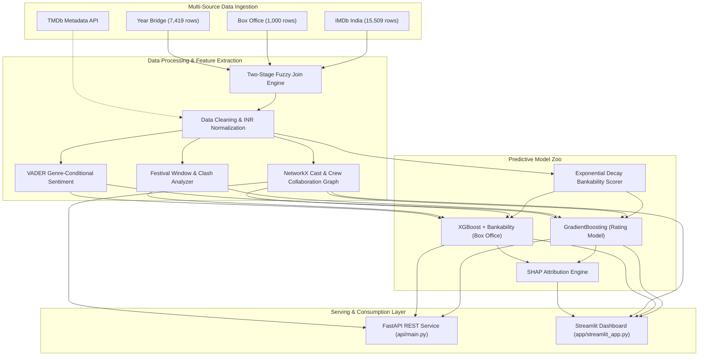

# Tamasha

[](https://github.com/themanoj-025/Tamasha/actions)
[](https://www.python.org/)
[](https://fastapi.tiangolo.com)
[](https://streamlit.io)
[](tests/)
[](LICENSE)

> A research-grade Bollywood box-office intelligence platform featuring multi-dataset fuzzy joining, 9-algorithm cross-validation, star bankability scoring, NetworkX collaboration chemistry networks, festival clash heuristics, and an interactive Streamlit and FastAPI suite.

---

## Quick Facts

| Dimension | Details |
| --- | --- |
| **Primary Domain** | Indian Cinema (Bollywood) rating and box office predictive intelligence |
| **Ingestion Methodology** | Two-tier fuzzy matching across 3 unkeyed Kaggle corpora (15.5k IMDb India, 1k Box Office, 7.4k Year Bridge) |
| **Ensemble Benchmark** | 9 regression algorithms × 5-fold CV × 3 distinct tasks = 135 evaluation runs |
| **Winning Estimators** | Rating: Tuned GradientBoosting (MAE 0.9534 / 10) · Box Office: Tuned XGBoost + Bankability (MAE ₹73.6 Cr) |
| **Star Chemistry Engine** | NetworkX collaboration graph with 3-year half-life exponential decay bankability modeling |
| **Temporal Heuristics** | 9 major national festival release windows with parametric clash collision detection |
| **Null Results Integrity** | Transparently documents poster computer vision null result (49.2% accuracy vs 51.1% random baseline) |
| **Test Verification** | 180 collected pytest tests including property-based Hypothesis invariants and API contracts |

---

## Table of Contents

- [Overview](#overview)
- [Key Results](#key-results)
- [System Architecture](#system-architecture)
- [Data Pipeline and Fuzzy Matching](#data-pipeline-and-fuzzy-matching)
- [Analytics and Modeling Engines](#analytics-and-modeling-engines)
- [Repository Structure](#repository-structure)
- [Quick Start](#quick-start)
- [API Reference](#api-reference)
- [Configuration](#configuration)
- [Verification and Testing](#verification-and-testing)
- [Roadmap](#roadmap)
- [Contributing](#contributing)
- [License](#license)

---

## Overview

Most film analytics projects stop at fitting a standard regression model onto a clean, flat table. **Tamasha** is built to address the real-world domain dynamics of Hindi cinema:

- **Star Chemistry vs. Solo Bankability**: Distinguishes between frequent collaborators and duos that empirically lift box office collections beyond their individual track records.
- **Festival Windows & Release Clashes**: Measures whether historic holiday windows (Diwali, Eid, Christmas) deliver genuine revenue multipliers or reflect selection bias, while detecting same-weekend release cannibalization.
- **Genre-Conditional Plot Tone**: Analyzes whether darker narratives correlate positively with revenue in thrillers while acting as a liability in broad comedies.
- **Methodological Transparency**: Fully publishes null findings—demonstrating that handcrafted poster aesthetic features (color palettes, face count, edge density) carry zero predictive power for commercial revenue.

---

## Key Results

| Metric | Empirical Value | Context & Benchmark |
| --- | --- | --- |
| **Best Rating Estimator** | **GradientBoosting (Tuned)** | MAE **0.9534 / 10** across 5-fold cross-validation |
| **Best Box Office Estimator** | **XGBoost (Tuned) + Bankability** | MAE **₹73.6 Cr** (outperforming Linear, Lasso, Ridge, RF, CatBoost) |
| **Bankability Lift** | **11.6% MAE Improvement** | Added feature vector cuts error by ₹9.7 Cr over baseline features |
| **Scored Individuals** | **1,010 Cast & Directors** | Exponential decay weighting with a 3-year half-life |
| **Fuzzy Matching Retention** | **81.2% High-Confidence Matches** | 812 enriched movies joined across 3 unlinked Kaggle datasets |
| **TMDb API Enrichment** | **93.2% Dates / 93.1% Overviews** | Enriched release schedules, synopses, and budget markers |
| **Computer Vision Classifier** | **49.2% Accuracy** | Reported null result (vs 51.1% naive baseline; no visual signal) |

---

## System Architecture



---

## Data Pipeline and Fuzzy Matching

Joining historical Indian cinema data poses a notorious reconciliation challenge: titles are transliterated inconsistently across platforms, release years are frequently missing, and box office figures use non-standard units (Crores, Lakhs, Billions).

1. **Title Disambiguation**: Applies token set ratio and Levenshtein distance through RapidFuzz.
2. **Two-Stage Bridge**:
   - Matches raw Box Office records against the Year Bridge corpus (achieving 99.4% resolution).
   - Performs a composite match on `normalized_title + year` against IMDb India (yielding 812 verified rows).
   - 93% of joined entities register a string similarity score $\ge 95/100$.
3. **Monetary Standardization**: Normalizes all domestic collections and budgets to absolute Indian Rupee (INR) floating values, adjusting for historical inflation.

---

## Analytics and Modeling Engines

### Star Bankability & Collaboration Networks

The bankability engine measures an individual's commercial track record using an exponential time-decay function:

$$W(t) = \exp\left(-\frac{\ln(2) \cdot \Delta t}{t_{1/2}}\right), \quad t_{1/2} = 3 \text{ years}$$

- **Dynamic Chemistry Uplift**: Measures whether an actor-director or co-star pairing generates higher normalized earnings than the sum of their individual rolling bankability averages.
- **Top Identified Chemistry Pairs**: Nawazuddin Siddiqui & Salman Khan (+0.0818 uplift), Jimmy Sheirgill & Kangana Ranaut (+0.0559 uplift).

### Festival Calendar & Clash Detection

- **Window Mapping**: Evaluates release timestamps against 9 major Indian holiday frames (Eid al-Fitr, Diwali, Republic Day, Independence Day, Gandhi Jayanti, Christmas).
- **Collision Sensitivity**: Detects direct release clashes within $\pm 7$ days to model audience attention dilution.

### Computer Vision Null Result

Tamasha processed 200 film posters using OpenCV to evaluate 63 handcrafted features: HSV color histograms, high-frequency edge gradients, and Haar-cascade face counts. Across multiple classifier architectures, validation accuracy hovered at 49.2% (against a 51.1% majority class baseline). We retain and document this component to uphold scientific integrity and discourage dead-end feature engineering.

---

## Repository Structure

```text
Tamasha/
├── api/                       # Production FastAPI REST implementation
│   ├── routers/               # Modular route endpoints
│   ├── deps.py                # Security dependencies and rate limiting
│   ├── main.py                # Server initialization and middleware
│   └── schemas.py             # Pydantic request and response models
├── app/                       # Streamlit multi-page analytical dashboard
│   ├── components/            # Visualizations and NetworkX graph renderers
│   ├── pages/                 # Multi-page dashboard layouts
│   └── streamlit_app.py       # Primary Streamlit application entry point
├── src/tamasha/               # Core analytical library package
│   ├── cv/                    # Poster feature extraction (null result artifact)
│   ├── data/                  # Loaders, cleaners, and fuzzy join pipelines
│   ├── evaluation/            # Cross-validation metrics and comparative tables
│   ├── features/              # Feature matrix builders and encoders
│   ├── models/                # Estimator wrappers and serialized artifacts
│   ├── network/               # Collaboration graph and chemistry pair metrics
│   ├── nlp/                   # VADER sentiment and plot tone extraction
│   ├── timing/                # Festival calendar and release clash heuristics
│   ├── config.py              # Centralized runtime settings
│   └── prediction_service.py  # Production model inference coordinator
├── tests/                     # 180 collected automated pytest tests
├── pyproject.toml             # Python build and Ruff configuration
├── requirements.txt           # Locked dependency manifest
└── Dockerfile                 # Container deployment specification
```

---

## Quick Start

### Prerequisites

- Python 3.11+
- Git

### Installation

```bash
# Clone repository
git clone https://github.com/themanoj-025/Tamasha.git
cd Tamasha

# Create and activate virtual environment
python -m venv .venv

# On Linux/macOS:
source .venv/bin/activate
# On Windows:
.venv\Scripts\Activate.ps1

# Install dependencies
pip install -r requirements.txt

# Install package in editable mode
pip install -e .
```

### Running the Services

```bash
# 1. Launch the Streamlit dashboard (opens on http://localhost:8501)
streamlit run app/streamlit_app.py

# 2. Launch the FastAPI backend server (listens on http://localhost:8000)
uvicorn api.main:app --reload --port 8000
```

---

## API Reference

The FastAPI server provides programmatic access to trained estimators and network graphs.

### Endpoints

| Method | Endpoint | Description | Query / Body |
| --- | --- | --- | --- |
| `GET` | `/health` | Service liveness and model artifact check | None |
| `POST` | `/predict/rating` | Predict film IMDb rating (0–10 scale) | JSON payload with genre, director, runtime |
| `POST` | `/predict/boxoffice` | Predict total commercial gross (INR) | JSON payload with budget, cast, festival date |
| `GET` | `/actors/{name}` | Individual bankability profile and filmography | Path parameter: `name` |
| `GET` | `/chemistry/pairs` | Ranked collaboration uplift pairs | Query: `limit`, `min_films` |

### Sample Request: Rating Prediction

```bash
curl -X POST "http://localhost:8000/predict/rating" \
  -H "Content-Type: application/json" \
  -d '{
    "genres": ["Action", "Thriller"],
    "director": "Siddharth Anand",
    "runtime_minutes": 146,
    "decade": 2020
  }'
```

---

## Configuration

Settings are controlled via environment variables or a local `.env` file (copied from `.env.example`).

| Variable | Description | Default | Required |
| --- | --- | --- | --- |
| `API_KEY` | Optional authentication key for protected prediction routes | *None* | No |
| `TMDB_API_KEY` | Optional key for live metadata enrichment | *None* | No |
| `RATE_LIMIT_PER_MINUTE` | SlowAPI rate limit quota for inference endpoints | `60` | No |
| `MODELS_DIR` | Filesystem path storing trained serialized models | `models` | No |
| `DATA_DIR` | Root storage directory for raw and processed datasets | `data` | No |

---

## Verification and Testing

Tamasha maintains an automated test suite executed via pytest with property-based Hypothesis tests and contract assertions.

```bash
# Execute test suite
pytest tests/ -v

# Run with test coverage measurement
pytest tests/ --cov=tamasha --cov-report=term-missing
```

- **Collected Tests**: 180 tests
- **Coverage Areas**:
  - Currency normalization and multi-unit parsing (Crores, Lakhs, Billions).
  - Hypothesis property tests asserting clash detection symmetry and boundary invariance.
  - Model serialization integrity checks (SHA-256 hash validation).
  - NetworkX graph construction and chemistry calculation edge cases.
  - FastAPI schema boundary contracts and HTTP error handling.

---

## Roadmap

- [x] Multi-corpus fuzzy reconciliation engine with high-confidence thresholds
- [x] 9-model cross-validated benchmarking for rating and box office
- [x] Star bankability modeling with 3-year half-life exponential decay
- [x] NetworkX collaboration chemistry network with uplift rankings
- [x] Festival calendar release clash heuristics
- [x] Verified null result documentation for poster computer vision
- [ ] Regional cinema expansion (Tollywood, Kollywood, Mollywood corpora)
- [ ] OTT streaming viewership prediction adapter
- [ ] Automated TMDb metadata synchronization daemon

---

## Contributing

Contributions are welcomed. Please review [CONTRIBUTING.md](CONTRIBUTING.md) and ensure that all new features include corresponding pytest test cases.

---

## License

This project is licensed under the MIT License — see the [LICENSE](LICENSE) file for complete details.
